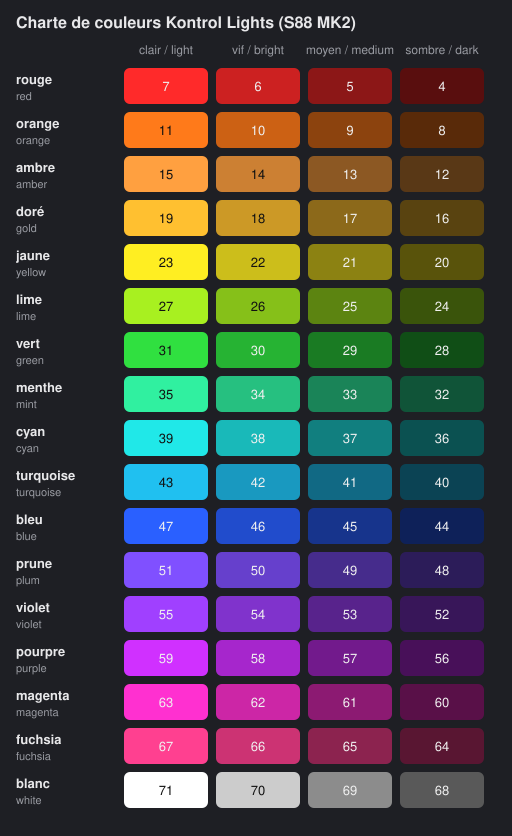

# Kontrol Lights

Allume les touches (light guide) d'un clavier **Komplete Kontrol S88 MK2** depuis
**Gig Performer 5** sous Windows, pour voir d'un coup d'œil les splits et les layers
de chaque rackspace. Fonctionne aussi en principe avec les S49 MK2 et S61 MK2.

Le projet contient deux pièces :

| Pièce | Fichier | Rôle |
|---|---|---|
| Extension Gig Performer | `KontrolLights.dll` | Parle au clavier en USB et affiche automatiquement les zones des blocs MIDI In |
| Plugin VST3 « Kontrol Lights Map » | `KontrolLightsMap-vst3.zip` | Fenêtre d'édition pour choisir la couleur de chaque note, une par une ou par plages |

L'extension suffit pour afficher les splits. Le plugin est optionnel.

---

## 1. Installation

### Prérequis
- Windows 10 ou 11, 64 bits
- Gig Performer 5 (l'extension est construite avec le SDK v62)
- Un Komplete Kontrol S88 MK2 branché en USB, avec les pilotes Native Instruments installés

### Télécharger
Prends les deux fichiers dans la dernière version de la page
[Releases](https://github.com/ljadov/s88mk2-gp-lights/releases/latest) du dépôt : `KontrolLights.dll` et `KontrolLightsMap-vst3.zip`.

### Installer l'extension
1. Ferme Gig Performer.
2. Copie `KontrolLights.dll` dans `C:\ProgramData\Gig Performer\Extensions`.
   Crée le dossier s'il n'existe pas. (`C:\ProgramData` est un dossier caché :
   tape le chemin directement dans la barre d'adresse de l'Explorateur.)
3. Relance Gig Performer. Il propose de charger l'extension « Kontrol Lights » : accepte.
4. Vérifie : menu **Extensions > Kontrol Lights : test arc-en-ciel**. Les touches
   doivent s'allumer en arc-en-ciel.

### Installer le plugin Kontrol Lights Map (optionnel)
1. Décompresse `KontrolLightsMap-vst3.zip` dans `C:\Program Files\Common Files\VST3\`.
   Tu dois obtenir le dossier `C:\Program Files\Common Files\VST3\Kontrol Lights Map.vst3`.
2. Relance Gig Performer et laisse-le analyser les nouveaux plugins
   (ou lance une nouvelle analyse depuis le gestionnaire de plugins).

### Mettre à jour
Ferme Gig Performer, remplace les fichiers aux mêmes endroits, puis relance.

---

## 2. Afficher les splits automatiquement

C'est le comportement par défaut. À chaque changement de rackspace, de variation ou
de partie de chanson, l'extension lit les blocs **MIDI In** du rackspace et allume
la plage de notes acceptée par chacun (réglages Min Note / Max Note du bloc).

1. **Donne un handle à chaque bloc MIDI In** : dans la vue câblage, clic droit sur
   le bloc, puis définis son handle. Gig Performer ne montre aux extensions que les
   blocs qui ont un handle. Sans handle, le bloc est ignoré.
2. Sans indication, chaque bloc reçoit une teinte différente, dans cet ordre :
   bleu, vert, orange, violet, jaune, rouge, cyan, fuchsia, puis les 8 autres teintes.
3. Pour choisir la couleur, mets son nom dans le nom du bloc, avec la nuance si tu veux :
   « Basse bleu », « Pad violet clair », « Lead rouge sombre », « Strings mint light ».
   Tous les noms sont dans la [charte de couleurs](#4-charte-de-couleurs).
4. Les touches couvertes par plusieurs blocs (layers) s'allument en **blanc**.
5. S'il y a des blocs MIDI In du Komplete Kontrol ou en OMNI, les blocs des autres
   contrôleurs sont ignorés.

Si tu changes la plage d'un bloc sans changer de rackspace, utilise
**Extensions > Kontrol Lights : reafficher les zones**.

---

## 3. Choisir la couleur de chaque note (Kontrol Lights Map)

1. Insère « Kontrol Lights Map » dans le rackspace. Pas besoin de le câbler : il
   ne touche pas au son.
2. **Donne-lui un handle** (clic droit sur le bloc). C'est ce qui permet à
   l'extension de relire ses couleurs à chaque changement de rackspace.
3. Ouvre son éditeur :
   - clic sur une touche pour la sélectionner ;
   - glisser, ou Maj+clic, pour sélectionner une plage ;
   - Ctrl+clic pour ajouter ou retirer des notes une à une ;
   - clic sur une couleur de la palette pour l'appliquer à la sélection.
4. Le clavier se met à jour en direct pendant l'édition.

Boutons :
- **Transparent** : la touche garde la couleur de sa zone MIDI In. L'éditeur montre
  cette couleur avec des hachures.
- **Éteint** : la touche reste éteinte, même si une zone la couvre.
- **Remplacer les zones MIDI In** : seules les couleurs du plugin sont affichées.
- **Tout sélectionner** et **Tout effacer**.

Les couleurs sont enregistrées avec le rackspace, comme les réglages de n'importe
quel plugin. Les couleurs de l'éditeur sont une approximation de celles du clavier.

---

## 4. Charte de couleurs

Le clavier offre **17 teintes** (16 couleurs et le blanc) en **4 nuances**, soit 68 couleurs.
Chaque couleur a un nom, utilisable partout : dans le nom d'un bloc MIDI In, en GPScript
et dans Kontrol Lights Map (le nom s'affiche quand la souris passe sur une couleur).



**Comment écrire un nom :** la teinte, puis éventuellement la nuance.
`bleu` (nuance vive par défaut), `bleu clair`, `bleu moyen`, `bleu sombre`.
En anglais : `blue`, `blue light`, `blue medium`, `blue dark`.
On peut aussi écrire la nuance en chiffre : `bleu 0` (sombre) à `bleu 3` (clair).
Majuscules et accents sont ignorés : `Doré`, `dore` et `DORE` sont équivalents.

| Teinte | Français | English | Clair | Vif | Moyen | Sombre |
|---|---|---|---|---|---|---|
| 1 | rouge | red | 7 | 6 | 5 | 4 |
| 2 | orange | orange | 11 | 10 | 9 | 8 |
| 3 | ambre | amber | 15 | 14 | 13 | 12 |
| 4 | doré | gold | 19 | 18 | 17 | 16 |
| 5 | jaune | yellow | 23 | 22 | 21 | 20 |
| 6 | lime | lime | 27 | 26 | 25 | 24 |
| 7 | vert | green | 31 | 30 | 29 | 28 |
| 8 | menthe | mint | 35 | 34 | 33 | 32 |
| 9 | cyan | cyan | 39 | 38 | 37 | 36 |
| 10 | turquoise | turquoise | 43 | 42 | 41 | 40 |
| 11 | bleu | blue | 47 | 46 | 45 | 44 |
| 12 | prune | plum | 51 | 50 | 49 | 48 |
| 13 | violet | violet | 55 | 54 | 53 | 52 |
| 14 | pourpre | purple | 59 | 58 | 57 | 56 |
| 15 | magenta | magenta | 63 | 62 | 61 | 60 |
| 16 | fuchsia | fuchsia | 67 | 66 | 65 | 64 |
| 17 | blanc | white | 71 | 70 | 69 | 68 |

Les nombres sont les numéros de couleur envoyés au clavier (teinte × 4 + nuance),
utilisables directement avec `KK_SetKey` et `KK_SetRange`. 0 éteint la touche.
Mots acceptés en plus : `rose` / `pink` (fuchsia), `mauve` (violet), `indigo` (prune),
`aqua` (cyan), `marine` (bleu), `foncé` / `deep` (sombre), `pâle` / `pastel` (clair).

Les couleurs de l'image sont une approximation : le rendu réel dépend des LED du clavier.

---

## 5. Cohabiter avec le plugin Komplete Kontrol

Le plugin Komplete Kontrol (via NI Hardware Integration Agent) écrit lui aussi sur
le light guide. L'extension renvoie ses couleurs toutes les 250 ms et se reconnecte
en une demi-seconde, pour reprendre la main. Un bref clignotement est possible quand
Komplete Kontrol écrit à son tour.

Dans un rackspace où tu préfères l'affichage de Komplete Kontrol, ajoute dans le
script du rackspace :

```
On Activate
   KK_SetYield(true)
End
```

L'extension ne touche alors plus aux lumières dans ce rackspace et reprend au
rackspace suivant.

---

## 6. Diagnostic et dépannage

Menu **Extensions > Kontrol Lights : diagnostic des blocs MIDI In**, puis ouvre le
**Script Logger** (menu Window de Gig Performer) pour lire le résultat. Il indique :
- si le clavier est connecté, et les interfaces USB Native Instruments vues par Windows ;
- le nombre d'erreurs d'écriture et la dernière erreur ;
- les blocs avec handle du rackspace et la plage lue pour chaque bloc MIDI In ;
- le plugin Kontrol Lights Map trouvé et le nombre de notes réglées.

| Symptôme | À vérifier |
|---|---|
| « L'extension est trop vieille » | Utilise la dernière `KontrolLights.dll` (SDK v62, Gig Performer 5) |
| « clavier MK2 non trouvé » | Clavier branché et allumé ; lis la liste des interfaces dans le diagnostic |
| « 0 zone(s) affichee(s) » | Les blocs MIDI In ont-ils un handle ? |
| Les lumières s'effacent dans certains rackspaces | Plugin Komplete Kontrol présent : voir la section 5 |
| Les couleurs du plugin ne reviennent pas au changement de rackspace | Le bloc Kontrol Lights Map a-t-il un handle ? |

### Clavier en « mode MIDI » (touches toutes bleues) sans plugin Komplete Kontrol

Quand aucun plugin Komplete Kontrol n'est chargé, le service Native Instruments remet
le clavier en mode MIDI : toutes les touches redeviennent bleues. L'extension renvoie
chaque seconde le message qui repasse le clavier en mode light guide, ce qui devrait
suffire. Si les touches restent bleues malgré tout, le dernier recours est d'arrêter les
services Native Instruments (Windows : `services.msc`, chercher « NI Hardware Service »,
« NI Host Integration Agent » et « NTK Daemon » ; noms à vérifier sur ta machine).
Contrepartie : le plugin Komplete Kontrol ne pilote plus le clavier (boutons, écrans,
navigation) tant que ces services sont arrêtés. Les notes MIDI fonctionnent toujours.

Test sans Gig Performer : installe Python, puis `pip install hidapi` et
`python tools/test_lightguide.py`. Le script liste les interfaces USB du clavier et
fait un balayage arc-en-ciel.

---

## 7. Fonctions GPScript

Utilisables dans les scripts de rackspace, de chanson, de gig et les scriptlets.

| Fonction | Rôle |
|---|---|
| `KK_SetKeyByName(note, name)` | allume une touche avec une couleur nommée : `KK_SetKeyByName(60, "bleu clair")` |
| `KK_SetRangeByName(low, high, name)` | allume une plage avec une couleur nommée |
| `KK_ColorByName(name)` | renvoie le numéro d'une couleur nommée (0 si le nom est inconnu) |
| `KK_SetKey(note, color)` | allume une touche (note MIDI ; 21 = A0, la plus grave du S88) |
| `KK_SetRange(low, high, color)` | allume une plage, bornes incluses |
| `KK_Clear()` | éteint tout |
| `KK_Color(hue, shade)` | renvoie une couleur par numéros : teinte 1 à 17, nuance 0 (sombre) à 3 (clair) |
| `KK_IsConnected()` | vrai si le clavier est détecté |
| `KK_SetAutoZones(bool)` | active ou désactive les zones automatiques (actives par défaut) |
| `KK_RefreshZones()` | relit les blocs MIDI In et réaffiche |
| `KK_SetZoneColor(handle, color)` | force la couleur de la zone d'un bloc MIDI In dans ce rackspace : `KK_SetZoneColor("Basse", KK_ColorByName("bleu clair"))` |
| `KK_SetYield(bool)` | `true` : laisse le light guide au plugin Komplete Kontrol dans ce rackspace |
| `KK_SetAutoClear(bool)` | éteint tout à chaque rackspace (quand les zones automatiques sont désactivées) |

Exemple : `scripts/example_rackspace.gpscript`.

---

## 8. Compiler soi-même

**Extension** (dossier racine) :
```
cmake -S . -B build -DCMAKE_BUILD_TYPE=Release
cmake --build build --config Release
cmake --install build --config Release   # copie la DLL dans le dossier Extensions
```

**Plugin** (dossier `plugin/`, JUCE 7.0.12 téléchargé automatiquement) :
```
cmake -S plugin -B build-plugin -DCMAKE_BUILD_TYPE=Release
cmake --build build-plugin --config Release
```

Sous Windows : Visual Studio 2022 et CMake. Depuis Linux, ajoute
`-DCMAKE_TOOLCHAIN_FILE=mingw-toolchain.cmake` (MinGW-w64) ; c'est ainsi que les
binaires de la release ont été produits.

## Organisation du code

| Dossier | Contenu |
|---|---|
| `src/` | Extension : `LibMain` (lien avec Gig Performer), `KontrolDevice` (USB HID), `Zones` (calcul des zones) |
| `plugin/` | Plugin VST3 Kontrol Lights Map (JUCE) |
| `shared/` | Format de la mémoire partagée entre l'extension et le plugin |
| `scripts/` | Exemple de script GPScript |
| `tools/` | Test Python du clavier, tests unitaires, génération de `docs/palette.svg` |
| `docs/` | Image de la charte de couleurs |

## Limites connues
- Le protocole USB du light guide n'est pas documenté par Native Instruments ; il
  vient de [SynthesiaKontrol](https://github.com/ojacques/SynthesiaKontrol).
- La palette affichée par le plugin est une approximation des couleurs du clavier.
- La transposition d'un bloc MIDI In n'est pas prise en compte : la zone affichée
  est la plage de notes acceptée par le bloc.
